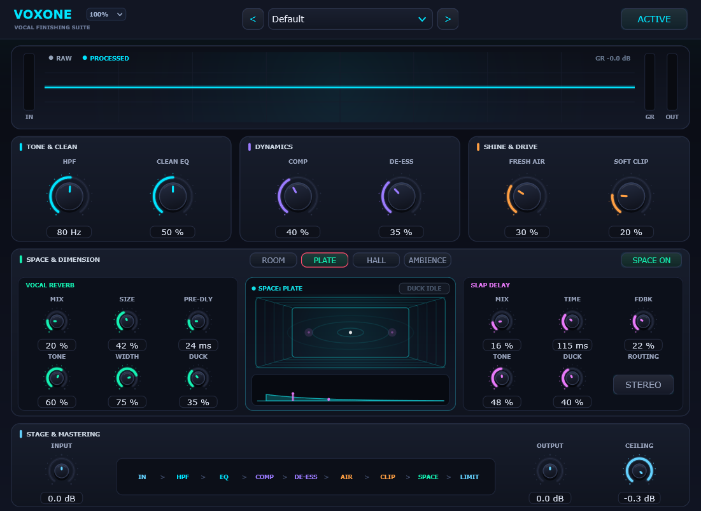

<div align="center">

# VOXONE

**All-in-One Vocal Finishing Suite for Windows (VST3)**

[](https://github.com/lacikapeek/VoxOne/releases/latest)
[](https://github.com/lacikapeek/VoxOne/releases/latest)
[](https://github.com/lacikapeek/VoxOne/releases/latest)
[](https://juce.com/)
[](https://isocpp.org/)

<br />



<br />

[Download v1.0.0](https://github.com/laszlokonyari/VoxOne/releases/tag/v1.0.0) · [Features](#features) · [Installation](#installation) · [Build from Source](#building-from-source)

</div>

---

## Overview

**VoxOne** is a modern, zero-allocation C++20 vocal processing suite built with JUCE 8. It combines essential vocal mixing, dynamics, harmonic excitement, spatial effects, and mastering protection into a single streamlined interface designed for fast workflow in FL Studio and other 64-bit Windows DAWs.

## Signal Chain

```text
INPUT → HPF → CLEAN EQ → COMP → DE-ESS → FRESH AIR → SOFT CLIP → SPACE (DELAY + REVERB) → OUTPUT → LIMITER
```

---

## Features

| Module | Processing & Controls |
| :--- | :--- |
| **Tone & Clean** | 24 dB/oct Butterworth High-Pass Filter (`20 Hz – 250 Hz`) and one-knob **Clean EQ** that attenuates mud (`260 Hz`), tames boxiness (`560 Hz`), and lifts vocal presence (`3.2 kHz`). |
| **Dynamics** | Soft-knee (`6 dB`) stereo-linked **Vocal Compressor** with automatic makeup gain and live Gain Reduction (GR) metering, paired with a phase-coherent dynamic EQ **De-Esser** (`7.2 kHz`). |
| **Shine & Drive** | **Fresh Air** high-frequency harmonic exciter with post-saturation cleanup and `10.5 kHz` air shelf, plus a threshold-based C¹-continuous **Soft Clipper** that adds warmth without raising the noise floor. |
| **Vocal Reverb** | Four tailored vocal spaces (**Room**, **Plate**, **Hall**, **Ambience**) with `MIX`, `SIZE`, modulated `PRE-DLY` (`0 – 120 ms`), Abbey Road-style `TONE`, stereo `WIDTH`, and automatic vocal **Ducking**. |
| **Slap Delay** | **Stereo** and **Ping-Pong** routing with click-free smoothed `TIME` (`30 – 450 ms`), analog-saturated `FDBK` (`0 – 75%`), band-shaped `TONE`, vocal **Ducking**, and subtle internal reverb send. |
| **Visual Feedback** | Dual-layer live **Raw vs. Processed Waveform Visualizer**, Peak-Hold **IN / GR / OUT** meters, active signal-chain indicator, and a real-time **3D Space & Decay Timeline Visualizer**. |
| **Stage & Mastering** | Smoothed `INPUT` / `OUTPUT` gain (`−24 dB` to `+24 dB`), instant A/B **Bypass**, dedicated **Space On/Off** toggle, and a brickwall **Output Limiter** (`−6.0 dB` to `−0.1 dB`). |
| **Responsive UI** | Vector-scaled interface with animated glow controls. Click the top-left **VOXONE** logo to scale between `65% – 150%` or select **Auto Fit** (`100%` = `884×646 px`). Scale preferences persist across sessions. |

---

## Factory Presets

VoxOne ships with **12 mix-ready vocal presets** accessible from both the plugin header and the DAW preset browser:

| | | |
| :--- | :--- | :--- |
| `01` **Default** | `05` **Pop Lead** | `09` **Ad-Libs** |
| `02` **Modern Rap** | `06` **R&B Smooth** | `10` **Warm Ballad** |
| `03` **Trap / Drill** | `07` **Hyperpop** | `11` **Podcast / Voice** |
| `04` **Melodic Rap** | `08` **Rock / Punk** | `12` **Lo-Fi Radio** |

---

## Installation

1. Download **`VoxOne-1.0.0-Windows-Setup.exe`** from the [GitHub Releases](https://github.com/laszlokonyari/VoxOne/releases/tag/v1.0.0) page.
2. Run the installer. It automatically installs the 64-bit VST3 plugin to:
   ```text
   C:\Program Files\Common Files\VST3\VoxOne.vst3
   ```
3. Open **FL Studio** (or any 64-bit VST3-compatible DAW), scan for new plugins (**Options → Manage plugins → Find installed plugins**), and load **VoxOne** on your vocal Mixer track.

> [!NOTE]
> Because the installer is currently unsigned, Windows SmartScreen may display a warning on launch. Click **More info → Run anyway** to continue the installation.

---

## Building from Source

### Prerequisites

- **OS:** Windows 10 / 11 (64-bit)
- **Compiler:** Visual Studio 2022 Build Tools (Desktop development with C++ / MSVC)
- **Tools:** CMake `3.22+` and Git (JUCE `8.0.4` is fetched automatically via CMake `FetchContent`)

### Compile

```bash
git clone https://github.com/lacikapeek/VoxOne.git
cd VoxOne
cmake -B build -G "Visual Studio 17 2022" -A x64
cmake --build build --config Release --target VoxOne_VST3
```

The compiled VST3 bundle will be generated at:

```text
build/VoxOne_artefacts/Release/VST3/VoxOne.vst3
```

---

## Tech Stack

- **Language:** C++20
- **Audio Framework:** JUCE 8.0.4 (`juce_audio_utils`, `juce_dsp`)
- **Build System:** CMake
- **Windows Installer:** Inno Setup

---

<div align="center">

Developed by **[laszlokonyari](https://github.com/laszlokonyari)**

</div>
